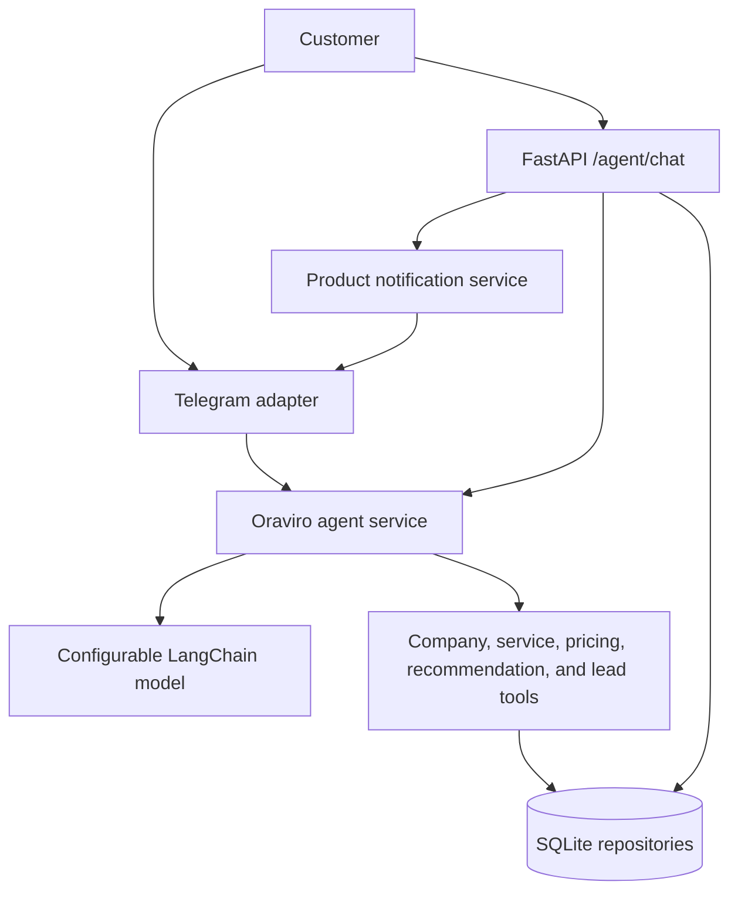

# Oraviro

Oraviro AI is Ora Viro's business consultant and sales agent. It explains verified digital, automation, and AI offerings, discovers a prospect's business needs, recommends relevant solutions, and can save consented lead summaries for the Ora Viro team. The Telegram adapter and FastAPI chat endpoint share the same consultant agent and SQLite-backed lead and conversation storage.

## Architecture



## Setup

Python 3.11+ is recommended. Install dependencies with `pip install -r requirements.txt`. Copy `.env.example` to `.env` and set a provider key. Supported providers are `groq` (`GROQ_API_KEY`) and `google` (`GOOGLE_API_KEY`); `LLM_MODEL` overrides each provider's default. `TELEGRAM_BOT_TOKEN` is needed for Telegram polling and product notifications. No credentials are committed.

The API creates `oraviro.db` at startup. Override its location with `ORAVIRO_DB_PATH`. The persistence layer creates a demo business and scopes catalog, customer, order, conversation, subscription, and lead records by business. On an older single-store database, startup copies existing records into that demo business inside a transaction; the old tables are removed only after the copy succeeds and foreign-key checks pass. Product and order administration endpoints remain available for client-solution development; they are not exposed as the Oraviro consultant's sales identity.

## Run

```powershell
uvicorn app.main:app --reload
python -m app.channels.telegram
```

Seed products independently with `python -m app.seed`.

## API

- `GET /health`
- `POST /agent/chat` with `{ "customer_id": "prospect_123", "message": "Hi" }`; optional `conversation_id` continues a specific thread. Returns response, conversation ID, and actual tool-call statuses.
- `GET, POST /products`, `GET, PUT, DELETE /products/{id}`
- `GET /orders`, `GET /orders/{id}`
- `GET /customers`
- `POST /subscriptions`, `DELETE /subscriptions/{id}`

Interactive API docs are at `/docs`. Product creation sends a best-effort Telegram notification to active new-product subscribers when the bot token exists.

Management endpoints (`/products`, `/orders`, `/customers`, `/leads`, and `/subscriptions`) require the `X-Admin-Key` request header. Set `ORAVIRO_ADMIN_API_KEY` to a long random secret before using them. `/health` and `/agent/chat` remain public.

## Consultant demo

Use `POST /agent/chat` for business discovery and solution recommendations. A first greeting introduces Oraviro AI and asks what kind of business the prospect runs. The agent uses the official Ora Viro catalog for service and package claims, asks one discovery question at a time, and only saves a lead summary after consent. Customer messages and lead profiles are isolated by customer ID and conversation ID. The consultant does not handle store product searches, inventory checks, or order placement.

Without provider credentials the app and APIs still work. The agent uses an official-catalog-grounded consultant fallback. A live model and Telegram delivery require valid external credentials. Telegram uses long polling and should run as a single process.

## Tests

Run `pytest`. SQLite can be redirected to a temporary file with `ORAVIRO_DB_PATH` before startup.

## Future integrations

Add WhatsApp, Instagram, Facebook Messenger, or web chat as channel adapters that call `chat_result`; business tools and persistence remain channel-independent. PostgreSQL can replace the SQLite repository implementation behind the same service operations.

### Local fallback and product alerts

If the LLM provider is unavailable or rate limited, Oraviro uses a company-catalog-grounded consultant fallback. Product administration and notification endpoints remain separate backend capabilities and are not part of the consultant conversation flow.
